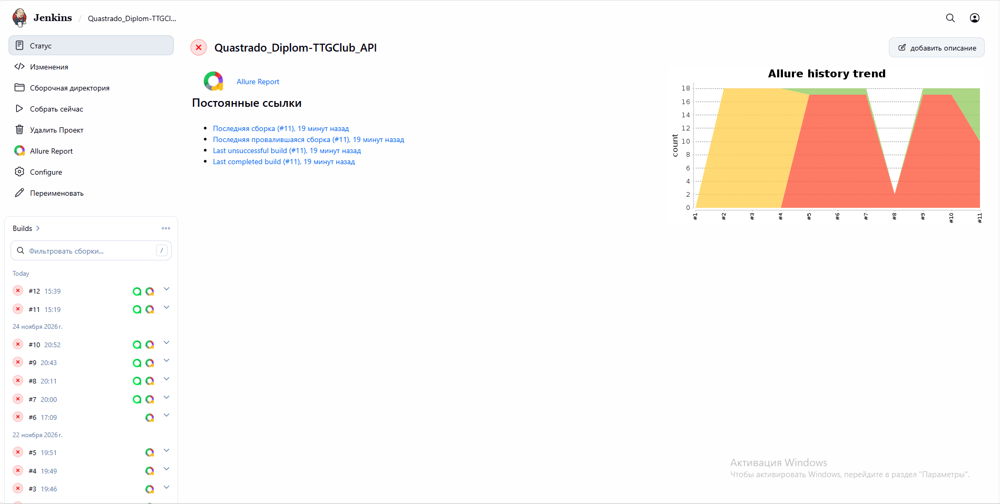
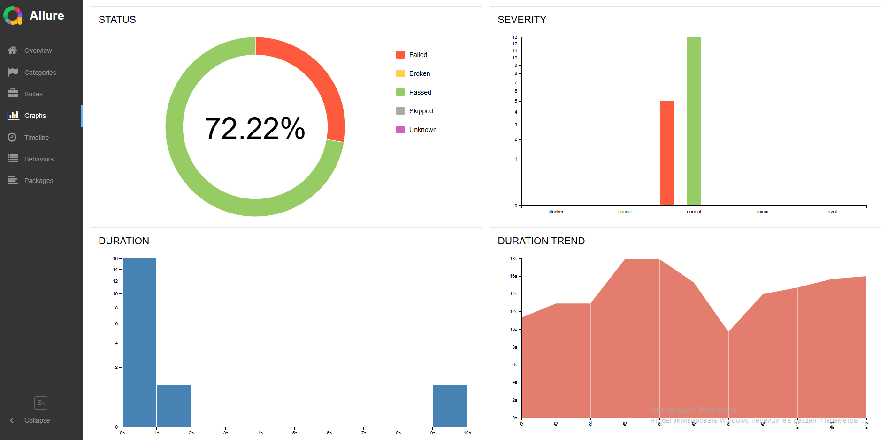
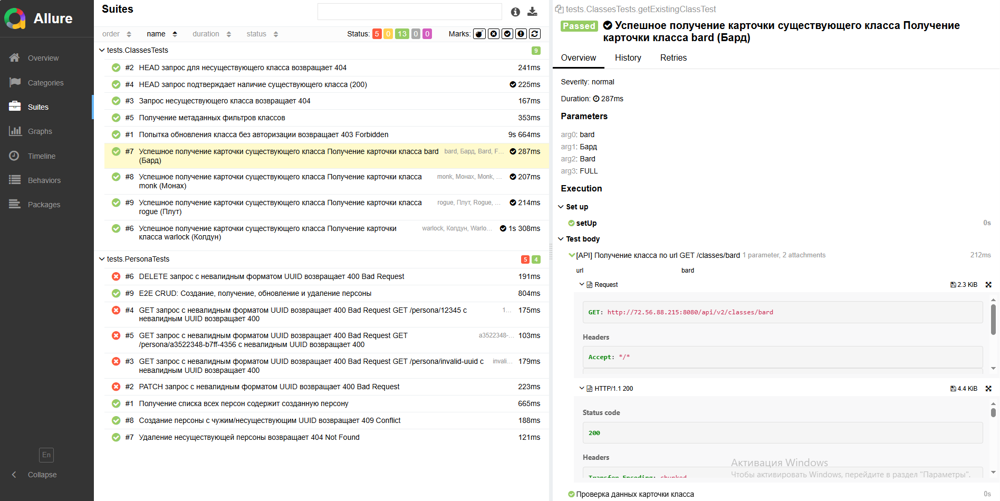
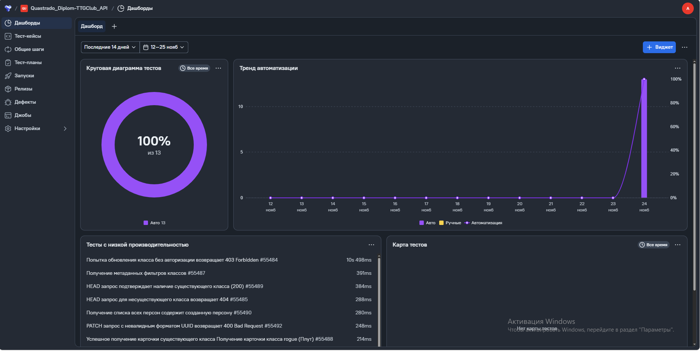
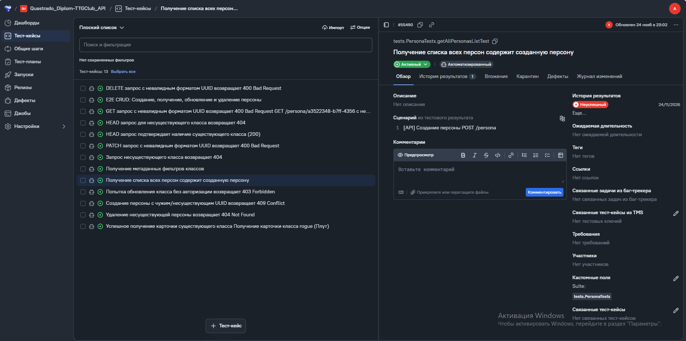
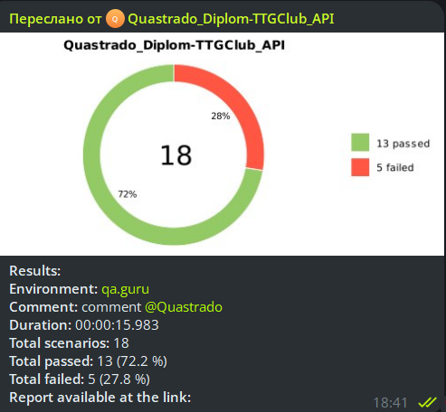

# Автоматизация API-тестирования TTG Club

Дипломный проект по проверке REST API справочника по D&D 5e (**TTG Club**).

## Содержание
- Технологический стек
- Покрытие тестами
- Запуск тестового стенда в Docker
- Инструкция по запуску тестов
- Интеграция с Jenkins
- Отчёты Allure и категории дефектов
- Работа с Allure TestOps
- Оповещения в Telegram

## Технологический стек
- **Язык и сборка**: Java, Gradle
- **Тестирование**: JUnit 5, REST Assured 6.0.0, AssertJ
- **Документация API**: Swagger / OpenAPI
- **Генерация данных и парсинг**: Datafaker, Jackson, Lombok
- **База данных и инфраструктура**: PostgreSQL 16, Docker, Docker Compose
- **CI/CD и аналитика**: Jenkins, Allure Report, Allure TestOps, Telegram Bot

## Покрытие тестами

### Классы персонажей (ClassesTests)
- [x] Получение списка доступных фильтров;
- [x] Проверка 404 при запросе несуществующего класса;
- [x] Параметризованное чтение карточек (проверка имён и типа заклинателя);
- [x] Проверка существования ресурса через HEAD-запросы (коды 200 и 404);
- [x] Проверка защиты от изменения без прав (403).

### Персоны (PersonaTests)
- [x] Полный жизненный цикл CRUD (создание, чтение, обновление через PATCH, удаление);
- [x] Обработка конфликта UUID (409) и отсутствия записи при удалении (404);
- [x] Поиск созданной записи в общем списке;
- [x] Проверка валидации неверного формата UUID (ожидается 400).

## Запуск тестового стенда в Docker

Для локального прогона тестов необходимо развернуть бэкенд приложения в контейнере и наполнить базу данных тестовыми записями:

1. Клонируйте репозиторий с исходным кодом API:
```bash
git clone https://github.com/TTG-Club/core-api
```

2. Поместите файл `docker-compose.yml` в корневую папку скачанного репозитория.

3. Перейдите в эту директорию и запустите сборку и поднятие контейнеров:
```bash
docker-compose up -d --build
```

4. После старта контейнеров наполните базу данных тестовыми классами и подклассами, выполнив SQL-скрипт [seed_classes.sql](src/test/resources/sql/seed_classes.sql) (команда выполняется из корневой папки текущего тестового проекта):
```bash
docker exec -i ttg-postgres psql -U postgres -d dnd5 < src/test/resources/sql/seed_classes.sql
```

После запуска сервис будет доступен по адресу `http://localhost:8080`. Для остановки и удаления контейнеров выполните:

```bash
docker-compose down
```

## Инструкция по запуску тестов

Запуск со стандартным адресом (`http://localhost:8080/api/v2`):

```bash
./gradlew clean test
```

Запуск с указанием другого стенда:

```bash
./gradlew clean test -DbaseUrl=https://example.com
```

## Интеграция с Jenkins
Сборка Quastrado_Diplom-TTGClub_API настроена в Jenkins с поддержкой параметров среды (например, передача `BASE_URL`) 





## Отчёты Allure и категории дефектов
После прогона формируется отчёт с логами запросов и ответов. В конфигурации настроена группировка падений по типам:
- Ошибки сервера (код 500 вместо 400);
- Продуктовые баги (несовпадение ожидаемых данных);
- Сбои окружения (статус broken).




## Работа с Allure TestOps
- Автоматическая загрузка результатов прогонов из Jenkins;


- Генерация актуальной тестовой документации на основе кода;

- Запуск сборок напрямую из интерфейса TMS.


## Оповещения в Telegram
По итогам сборки утилита уведомлений отправляет в чат диаграмму со статистикой прохождения и ссылку на отчёт.


